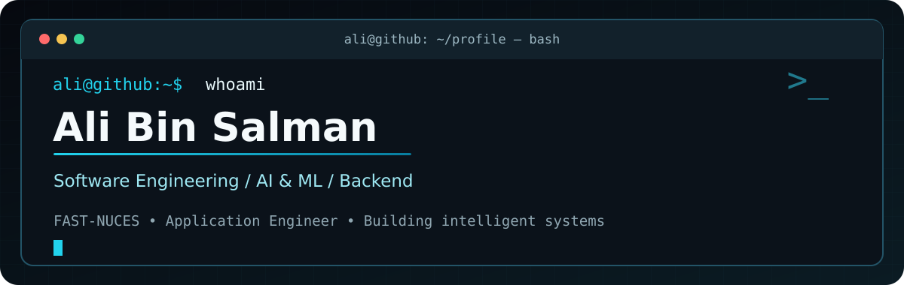

<div align="center">

  

  <br>

  

</div>

---

## 👨‍💻 About Me

```text
$ whoami
  Ali Bin Salman | Senior-year CS undergraduate @ FAST-NUCES

$ currently
  Application Engineer @ SavvPro
  Backend services, APIs, SaaS and microservice workflows

$ focus
  Software Engineering · Agentic AI · Deep Learning · Cloud/DevOps

$ mission
  Build reliable applications from idea to deployment.
```

I'm a computer science undergraduate working across **backend development** and **AI/ML**, with experience building APIs, SaaS systems, and intelligent applications. I enjoy solving engineering problems from system design through implementation and deployment.

## 🧭 Fields of Interest

| 🧩 Software Engineering | 🧠 AI / Machine Learning |
| :--- | :--- |
| Backend systems, APIs, SaaS and microservices | LLMs, agentic workflows, NLP, RAG and deep learning |
| 📊 **Data Science** | ☁️ **Cloud & DevOps** |
| Predictive modeling and data-driven systems | AWS, containers, CI/CD and cloud-native infrastructure |

## 🛠️ Tech Stack & Languages

### Languages
<p>
  
  
  
  
  
</p>

### Backend & Web
<p>
  
  
  
  
</p>

### AI / ML
<p>
  
  
  
  
  
</p>

### Databases
<p>
  
  
  
  
  
</p>

### Cloud & DevOps
<p>
  
  
  
  
  
  
</p>

## 🚀 Featured Portfolio

### 01 · Chronaide — Sovereign Multi-Agent Intelligence System

Privacy-preserving AI assistant with a multi-agent reasoning pipeline and hybrid GraphRAG memory. **LangGraph · Ollama · FastAPI · Neo4j · Qdrant**

### 02 · MeetingMind AI Platform

AI-powered meeting intelligence with transcript processing, automated meeting bot deployment, calendar extraction, and real-time voice agent integration. **FastAPI · LiveKit · MongoDB · OpenAI**

### 03 · Base-Hive SaaS Platform

Multi-tenant white-label social media management: cross-platform publishing, scheduling, analytics, and API-driven workflows. **Next.js · FastAPI · PostgreSQL · Redis · Docker**

### 04 · DevSecOps Cloud Deployment

Secure CI/CD pipeline with vulnerability scanning, deployment automation, and monitoring. **Jenkins · Docker · AWS EC2 · Prometheus · Grafana · Argo CD**

### 05 · Intelligent Reading Comprehension Quiz Generator

ML-assisted quiz generation, answer verification, distractors, and graduated hints using the RACE dataset. **Streamlit · TF-IDF · SVM · Random Forest · Logistic Regression**

> **Project links:** Add repository/demo links to the entries above when you're ready to share them. Some projects may be private or employer-owned.

## 📊 Developer Dashboard

<div align="center">


</div>

*Language charts reflect GitHub repository code statistics, not overall proficiency.*

## 📈 Contribution Activity

<div align="center">


</div>

## 📬 Connect With Me

<div align="center">

[](mailto:alibinsalman909@gmail.com)
[](https://github.com/AliSalman909)

<!-- Add your verified LinkedIn and portfolio URLs here when ready. -->

</div>
